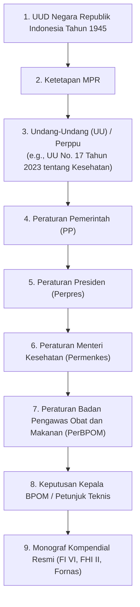

# Indonesian Pharmaceutical Regulatory Hierarchy & Standards

This reference document outlines the statutory hierarchy, primary legislations, official compendia, and institutional mandates governing pharmaceuticals, traditional medicines, health supplements, and cosmetics in the Republic of Indonesia.

---

## 1. Statutory Hierarchy of Indonesian Law

Under **Undang-Undang Nomor 12 Tahun 2011** tentang Pembentukan Peraturan Perundang-undangan (jo. **UU No. 13 Tahun 2022**), legal instruments in Indonesia follow a strict hierarchy of precedence:

### Statutory Precedence Rules:
- **Lex Superior Derogat Legi Inferiori**: Lower regulations cannot contradict higher regulations.
- **Lex Specialis Derogat Legi Generali**: Special rules supersede general provisions on the same subject.
- **Lex Posterior Derogat Legi Priori**: A newer regulation supersedes an older regulation if of equal hierarchy.

---

## 2. Key Primary Legislations (UU & PP)

### UU No. 17 Tahun 2023 tentang Kesehatan (Omnibus Health Law)
- Replaced and consolidated previous health statutes (UU 36/2009 Kesehatan, UU 35/2009 Narkotika [partially harmonized], UU 44/2009 Rumah Sakit, UU Tenaga Kesehatan, etc.).
- **BAB VIII: Sediaan Farmasi, Alat Kesehatan, dan Perbekalan Kesehatan Rumah Tangga (PKRT)**:
  - **Pasal 138 - 145**: Standard mutu, khasiat, dan keamanan sediaan farmasi. Kewajiban memiliki Izin Edar (NIE).
  - **Pasal 146 - 150**: Ketentuan CPOB (Cara Pembuatan Obat yang Baik) dan CPOTB (Cara Pembuatan Obat Tradisional yang Baik).
  - **Pasal 435 - 440**: Sanksi pidana dan denda bagi peredaran obat tanpa izin edar atau tidak memenuhi standar mutu/farmakope.

---

## 3. Peraturan Kementerian Kesehatan (Permenkes)

- **Permenkes No. 1010/MENKES/PER/XI/2008** (jo. Permenkes No. 1120/MENKES/PER/XII/2010) tentang Registrasi Obat.
  - Dasar pendelegasian wewenang evaluasi teknis dan penerbitan izin edar obat kepada Kepala Badan POM.
- **Permenkes tentang Standar Pelayanan Kefarmasian** (Apotek, Rumah Sakit, Puskesmas).
- **Keputusan Menteri Kesehatan (Kepmenkes) tentang Formularium Nasional (Fornas)**:
  - Daftar obat terpilih yang dibutuhkan oleh sebagian besar populasi untuk program Jaminan Kesehatan Nasional (JKN/BPJS Kesehatan). Diperbarui secara berkala oleh Komite Nasional Formularium Nasional.

---

## 4. Peraturan Badan Pengawas Obat dan Makanan (PerBPOM)

BPOM RI (*Badan Pengawas Obat dan Makanan*) regulates and supervises drugs, drug substances, biologics, traditional medicines, cosmetics, and food.

### Core Drug Regulations
1. **Peraturan BPOM No. 24 Tahun 2017 tentang Kriteria dan Tata Laksana Registrasi Obat**:
   - Master regulation for drug registration in Indonesia.
   - Categorizes registration types:
     - **Kategori 1, 2, 3**: Registrasi Baru (Obat Baru, Produk Biologi, Obat Copy).
     - **Kategori 4, 5, 6**: Registrasi Variasi (Mayor, Minor dengan Persetujuan, Minor dengan Notifikasi).
     - **Kategori 7**: Registrasi Ulang (Renewal).
2. **Peraturan BPOM No. 15 Tahun 2019 & PerBPOM No. 13 Tahun 2022**:
   - Perubahan atas kriteria tata laksana registrasi obat (penyederhanaan evaluasi, digital submission e-registration ASROT).
3. **Peraturan BPOM No. 34 Tahun 2018 tentang Pedoman Cara Pembuatan Obat yang Baik (CPOB)**:
   - Harmonized with PIC/S (Pharmaceutical Inspection Co-operation Scheme) guidelines.
   - Accompanied by **POPP CPOB Jilid I & II** (Petunjuk Operasional Penerapan CPOB).
4. **Peraturan BPOM No. 27 Tahun 2020 tentang Standar Pelayanan Publik di Lingkungan BPOM**:
   - Defines official SLAs, processing days (hari kerja), and statutory non-tax state revenue (PNBP).
5. **Peraturan BPOM No. 31 Tahun 2018 tentang Label dan Penandaan Obat**:
   - Mandatory package insert (PIL/Brosur), blister/strips, and outer carton labeling rules (bahasa Indonesia, batch number, exp date, NIE, barcode 2D QR).
6. **Peraturan KaBPOM tentang Uji Bioekivalensi (BE)**:
   - Pedoman Uji Bioekivalensi dan Daftar Obat yang Wajib Uji Ekivalensi in vivo.

---

## 5. Official Compendia & Monographs

### Farmakope Indonesia (FI)
- **Status Hukum**: Standar mutu resmi sediaan farmasi di Indonesia (Pasal 138 UU 17/2023).
- **Edisi Berlaku**:
  - **Farmakope Indonesia Edisi VI (2020)**.
  - Suplemen I FI VI, Suplemen II FI VI, dan Suplemen III FI VI.
- **Komponen**: Ketentuan Umum, Monografi Bahan Aktif (API), Monografi Sediaan Jadi (Finished Product), dan Metode Analisis Umum (Kromatografi, Spektrofotometri, Disolusi, Uji Batas Mikroba, Endotoksin Bakteri).
- **Prinsip Kompendial**: Jika suatu obat belum terdapat dalam FI VI, pemohon dapat merujuk pada kompendia internasional yang diakui:
  - United States Pharmacopeia (USP)
  - European Pharmacopoeia (Ph. Eur.)
  - British Pharmacopoeia (BP)
  - Japanese Pharmacopoeia (JP)
  - International Pharmacopoeia (Ph. Int. - WHO)

### Farmakope Herbal Indonesia (FHI)
- **Edisi Berlaku**: Farmakope Herbal Indonesia Edisi II (2017) & Suplemen.
- **Ruang Lingkup**: Standar mutu simplisia, ekstrak, dan penandaan senyawa penanda (*marker compounds*) untuk obat bahan alam (Jamu, OHT, Fitofarmaka).

### Formularium Nasional (Fornas)
- Keputusan Menteri Kesehatan RI yang memuat daftar obat esensial terpilih, restriksi peresepan, peresepan maksimal, dan tingkat fasilitas kesehatan (Faskes 1, 2, 3) yang berhak memberikan obat dalam skema JKN.

---

## 6. Official Regulatory Repositories

When conducting legal lookups, verify against these official Indonesian portals:
- **JDIH BPOM**: [jdih.pom.go.id](https://jdih.pom.go.id) - Peraturan BPOM, Keputusan Kepala BPOM, Surat Edaran BPOM.
- **JDIH Kemenkes**: [jdih.kemkes.go.id](https://jdih.kemkes.go.id) - Undang-Undang Kesehatan, Permenkes, Kepmenkes.
- **PIONAS (Pusat Informasi Obat Nasional)**: [pionas.pom.go.id](https://pionas.pom.go.id) - Informasi resmi indikasi, kontraindikasi, dosis obat yang beredar.
- **Cek BPOM**: [cekbpom.pom.go.id](https://cekbpom.pom.go.id) - Verifikasi Nomor Izin Edar (NIE) produk terdaftar.
