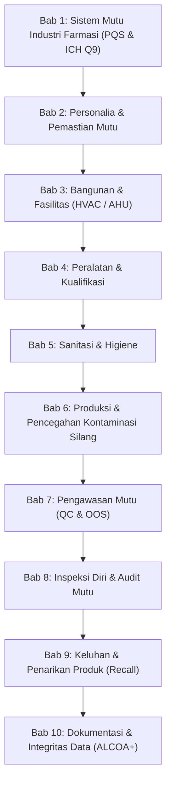

# PerBPOM No. 34 Tahun 2018: Pedoman Cara Pembuatan Obat yang Baik (CPOB)

This folder contains the authoritative reference guides, operational standards (POPP CPOB), sterile manufacturing updates (PIC/S Annex 1), and validation protocols under **Peraturan BPOM No. 34 Tahun 2018**.

---

## 1. Regulatory Status & Harmonization

- **Regulasi Induk**: Peraturan BPOM No. 34 Tahun 2018 tentang Pedoman Cara Pembuatan Obat yang Baik.
- **Payung Hukum**: UU No. 17 Tahun 2023 tentang Kesehatan (Pasal 146: Kewajiban Sertifikasi CPOB).
- **Harmonisasi Internasional**: PIC/S (*Pharmaceutical Inspection Co-operation Scheme*) Guide to GMP for Medicinal Products PE 009-14 & updates.
- **Petunjuk Operasional**: POPP CPOB Jilid I (Sarana Pembuatan Sediaan Non-Steril & Prinsip Umum) dan POPP CPOB Jilid II (Sarana Pembuatan Sediaan Khusus & Steril).

---

## 2. Struktur Bab Pokok CPOB 2018

---

## 3. Documents in This Folder

1. [**`aneks_1_sterile_and_ccs.md`**](./aneks_1_sterile_and_ccs.md):
   - Standar mutakhir pembuatan produk steril harmonisasi PIC/S Annex 1.
   - Prinsip **Contamination Control Strategy (CCS)**.
   - Ketentuan **PUPSIT** (*Pre-Use Post-Sterilization Integrity Testing*).
   - Klasifikasi ruang bersih Grade A, B, C, dan D, serta sistem isolator/RABS.
2. [**`aneks_8_process_validation.md`**](./aneks_8_process_validation.md):
   - Ketentuan validasi proses tradisional minimal 3 bets berturut-turut.
   - Pendekatan Continuous Process Verification (CPV) dan hybrid.
   - Critical Process Parameters (CPP) & Critical Quality Attributes (CQA).
3. [**`data_integrity_guidelines.md`**](./data_integrity_guidelines.md):
   - Prinsip ALCOA+ (Attributable, Legible, Contemporaneous, Original, Accurate + Complete, Consistent, Enduring, Available).
   - Audit trail review, kontrol akses, dan validasi sistem terkomputerisasi (Annex 11).
4. [**`cpob_audit_checklist.json`**](./cpob_audit_checklist.json):
   - Daftar periksa inspeksi mandiri (*self-inspection*) berformat JSON untuk penilaian kesiapan sertifikasi CPOB BPOM.
