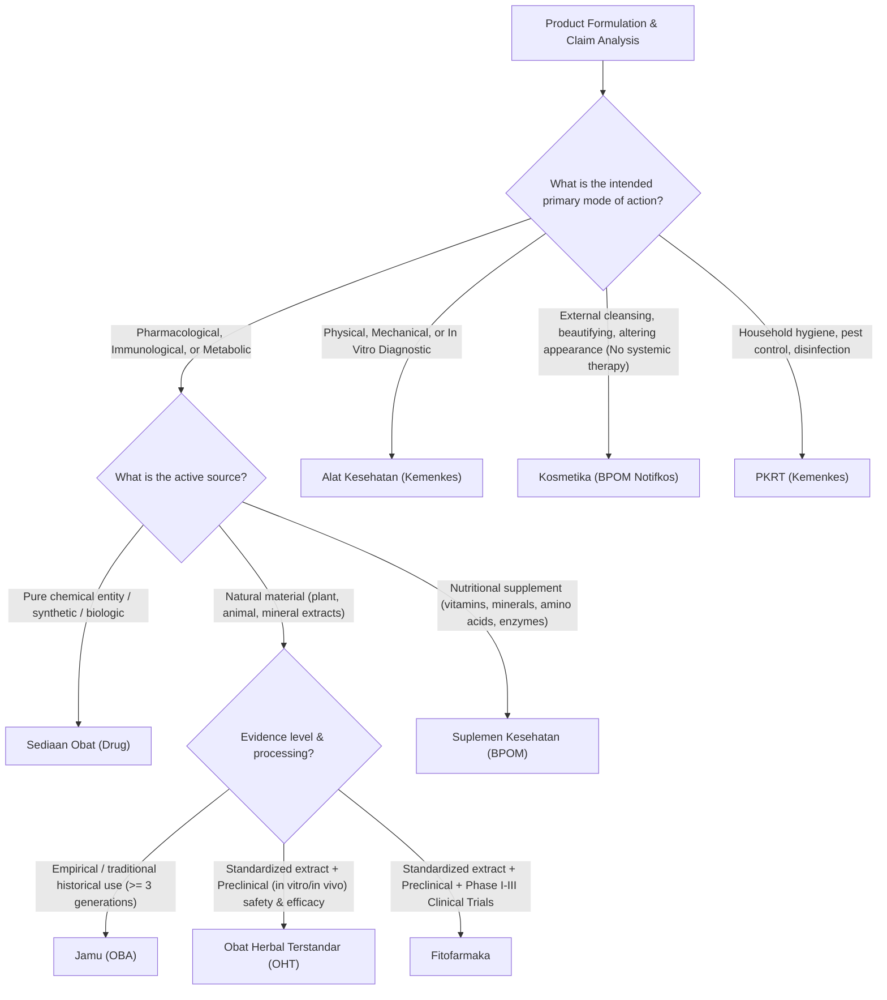

# Pharmaceutical Product Classification & Borderline Guide

This reference provides classification criteria, legal definitions, registration pathways, and borderline resolution rules under the jurisdiction of the Indonesian Food and Drug Authority (BPOM) and Ministry of Health.

---

## 1. Classification Decision Flowchart

---

## 2. Category Profiles & Regulatory Rules

### A. Sediaan Obat Jadi (Pharmaceutical Drug Products)
- **Regulasi**: UU 17/2023, Permenkes 1010/2008, PerBPOM 24/2017.
- **Dossier Format**: ACTD 4 Parts (Parts I - IV).
- **Sub-Klasifikasi & Simbol Penandaan**:
  1. **Obat Bebas**: Lingkaran bulat hijau dengan garis tepi hitam. Dijual bebas di toko obat dan apotek tanpa resep dokter.
  2. **Obat Bebas Terbatas**: Lingkaran bulat biru dengan garis tepi hitam. Disertai tanda peringatan resmi (P.No. 1 s/d P.No. 6).
     - *P.No. 1: Awas! Obat Keras. Bacalah aturan memakainya.*
     - *P.No. 2: Awas! Obat Keras. Hanya untuk kumur, jangan ditelan.*
     - *P.No. 3: Awas! Obat Keras. Hanya untuk bagian luar badan.*
     - *P.No. 4: Awas! Obat Keras. Hanya untuk dibakar.*
     - *P.No. 5: Awas! Obat Keras. Tidak boleh ditelan.*
     - *P.No. 6: Awas! Obat Keras. Wasir, jangan ditelan.*
  3. **Obat Keras**: Lingkaran bulat merah dengan garis tepi hitam dan huruf **K** hitam di tengah menyentuh garis tepi. Wajib resep dokter (Ethical drug). Termasuk antibiotika, hormon, obat suntik.
  4. **Psikotropika**: Obat keras yang berkhasiat psikoaktif melalui pengaruh selektif pada susunan saraf pusat.
  5. **Narkotika**: Lingkaran bulat dengan palang medali merah di tengahnya. Pengawasan ketat (UU No. 35/2009 jo. UU 17/2023).

---

### B. Obat Bahan Alam / OBA (Natural Medicine)
- **Regulasi**: Peraturan BPOM tentang Kriteria dan Tata Laksana Pendaftaran Obat Bahan Alam.
- **Tiga Tingkatan Bukti**:
  1. **Jamu**:
     - *Bukti*: Data empiris penggunaan turun-temurun minimal 3 generasi (> 90 tahun).
     - *Logo*: Lingkaran hijau berisi gambar pohon/ranting daun hijau.
     - *Klaim*: "Secara tradisional digunakan untuk..."
  2. **Obat Herbal Terstandar (OHT)**:
     - *Bukti*: Ekstrak terstandar memenuhi persyaratan Farmakope Herbal Indonesia + Uji Praklinik (toksisitas akut/subkronik & uji farmakodinamik).
     - *Logo*: Lingkaran hijau berisi 3 buah bintang hijau.
     - *Klaim*: Klaim khasiat ilmiah sesuai hasil uji praklinik.
  3. **Fitofarmaka**:
     - *Bukti*: Ekstrak terstandar CPOB/CPOTB + Uji Praklinik lengkap + Uji Klinik (Fase I, II, dan/atau III pada manusia).
     - *Logo*: Lingkaran hijau berisi kristal salju/jari-jari hijau.
     - *Klaim*: Klaim terapeutik medis dan dapat diresepkan dokter serta masuk dalam Formularium Fitofarmaka Kemenkes.

---

### C. Suplemen Kesehatan (Health Supplements)
- **Definisi**: Produk yang dimaksudkan untuk melengkapi kebutuhan gizi, memelihara, meningkatkan, dan/atau memperbaiki fungsi kesehatan, mempunyai nilai gizi dan/atau efek fisiologis, mengandung satu atau lebih bahan berupa vitamin, mineral, asam amino, atau bahan lain (bukan tumbuhan) yang dapat dikombinasi dengan tumbuhan.
- **Batas Maksimum Dosis Harian (Angka Kecukupan Gizi / Batas Maksimum BPOM)**:
  - Mengacu pada PerBPOM Batas Maksimum Vitamin dan Mineral dalam Suplemen Kesehatan.
  - *Contoh*: Vitamin C dosis hingga 1000 mg/hari (suplemen); Vitamin C dosis > 1000 mg atau sediaan injeksi diklasifikasikan sebagai **Obat Keras**.
  - Vitamin D3: Dosis harian $\le 4000\text{ IU}$ diklasifikasikan sebagai Suplemen; Dosis $> 4000\text{ IU}$ (misal 5000 IU tablet / drop) didaftarkan sebagai **Obat Keras**.

---

### D. Kosmetika
- **Definisi**: Bahan atau sediaan yang dimaksudkan untuk digunakan pada bagian luar tubuh manusia (epidermis, rambut, kuku, bibir, dan organ genital bagian luar) atau gigi dan membran mukosa mulut, terutama untuk membersihkan, mewangikan, mengubah penampilan, dan/atau memperbaiki bau badan atau melindungi atau memelihara tubuh pada kondisi baik.
- **Regulasi**: Notifikasi Kosmetika secara daring (Notifkos BPOM). Masa berlaku notifikasi: 3 tahun.
- **Batasan**: Tidak boleh mengklaim mengobati atau memulihkan fungsi fisiologis (misal: tidak boleh klaim "menghilangkan infeksi jamur", "menumbuhkan rambut secara permanen", "mengobati jerawat hormonal parah").

---

## 3. Borderline Case Resolution Matrix

| Factor | Obat (Drug) | Suplemen Kesehatan | Obat Bahan Alam | Kosmetika |
| :--- | :--- | :--- | :--- | :--- |
| **Primary Intent** | Diagnosis, pengobatan, mitigasi penyakit | Melengkapi nutrisi, memelihara fungsi tubuh | Memelihara kesehatan berbasis bahan alam | Estetika, pembersihan, perlindungan luar |
| **Permitted Claims** | Indikasi medis eksplisit (e.g. *Antihipertensi, antibiotik*) | Klaim struktur/fungsi nutrisi (*Membantu memelihara daya tahan tubuh*) | Klaim empiris atau uji praklinik/klinik | Klaim kosmetik luar (*Mencerahkan, melembapkan*) |
| **Administration Route** | Oral, parenteral, topikal, inhalasi, rektal | Oral (kapsul, tablet, serbuk, cairan oral) | Oral, topikal (luar) | Topikal eksternal, rambut, mukosa oral luar |
| **Safety Threshold** | Risk/benefit analysis per indikasi penyakit | Batas Tolerable Upper Intake Level (UL) | Bebas Bahan Kimia Obat (BKO) | Negatif list bahan berbahaya (raksa, hidrokuinon, tretinoin) |
| **Fasilitas Pembuatan** | Sertifikat CPOB | Sertifikat CPOTB / CPOB | Sertifikat CPOTB | Sertifikat CPKB |
