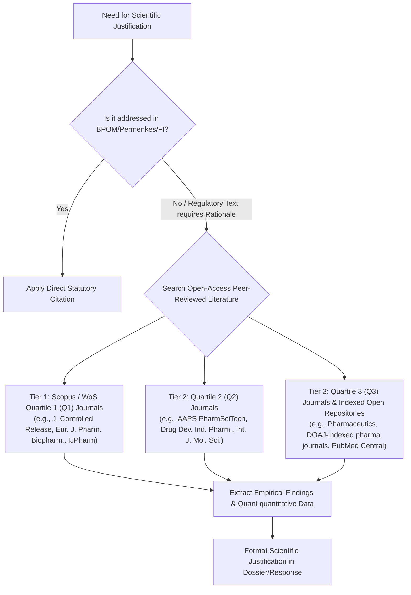

# Scientific Literature Evidence Protocol (Q1–Q3 Peer-Reviewed Fallback)

This document establishes the protocol for citing peer-reviewed open-access scientific literature when regulatory statutes or compendial monographs (UU Kesehatan, Permenkes, PerBPOM, Farmakope Indonesia) are silent, ambiguous, or explicitly require scientific justification (*scientific rationale / dossier justification*).

---

## 1. When to Invoke the Literature Protocol

The agent must invoke this protocol under the following circumstances:
1. **Compendial Absence**: The active ingredient, excipient, formulation type, or analytical test method is not yet monographed in Farmakope Indonesia (FI VI) or recognized international pharmacopeias (USP, Ph.Eur, BP, JP).
2. **Toxicological & Safety Thresholds**: Calculating Permitted Daily Exposure (PDE), Threshold of Toxicological Concern (TTC) for elemental or genotoxic impurities (ICH Q3A/B/C/D, ICH M7) where empirical in vitro/in vivo data is needed.
3. **Formulation Compatibility & Novel Excipients**: Justifying non-standard excipient concentrations, co-processed excipients, or novel drug delivery systems (e.g., lipid nanoparticles, cyclodextrin complexes).
4. **Biowaiver & Dissolution Justification**: Explaining solubility, permeability, dissolution mechanisms, or bioequivalence borderlines in ACTD Part II/IV.
5. **Stability Kinetics & Degradation Pathways**: Explaining shelf-life extrapolation or specific degradation degradant toxicity in Climatic Zone IVb.

---

## 2. Source Ranking & Eligibility Criteria

Evidence must satisfy rigorous scientific credibility standards:



### Eligible Databases:
- **PubMed Central (PMC) / PubMed**: [ncbi.nlm.nih.gov/pmc](https://www.ncbi.nlm.nih.gov/pmc/)
- **DOAJ (Directory of Open Access Journals)**: [doaj.org](https://doaj.org)
- **ScienceDirect / Wiley / Springer Open Access Articles**
- **Scimago Journal & Country Rank (SJR)**: To verify Q1, Q2, or Q3 quartile standing.

### Ineligible Sources (Do NOT use for regulatory justification):
- Non-peer-reviewed blog posts or commercial vendor promotional flyers.
- Predatory journals (not indexed in DOAJ, Scopus, or Web of Science).
- Unverified forum opinions or Wikipedia.

---

## 3. Mandatory Citation Syntax

When presenting scientific literature evidence, format the citation strictly as follows:

```markdown
> 🔬 **Dasar Pembenaran Ilmiah (Scientific Rationale)**:
> - **Penulis & Tahun**: [Author 1, Author 2, et al.], [Tahun Publikasi]
> - **Judul Artikel**: "[Judul Lengkap Naskah Ilmiah]"
> - **Jurnal & Peringkat**: *[Nama Jurnal Internasional]*, Vol.[X], No.[Y], hal. [Z] (Scopus [Q1 / Q2 / Q3] / PubMed Central)
> - **Identifikasi Unik**: DOI: `10.xxxx/xxxxx` | PMID: `xxxxxxx` | Open Access
> - **Temuan Kunci / Bukti Empiris**: [Rangkuman kuantitatif: e.g., "Uji permeabilitas Caco-2 menunjukkan nilai Papp 1.8 x 10^-5 cm/s, mengonfirmasi permeabilitas tinggi untuk klasifikasi BCS Kelas I..."]
> - **Relevansi Regulasi BPOM / ACTD**: [Penjelasan korelasi dengan kelengkapan Part II/IV ACTD]
```

---

## 4. Evaluation of Scientific Rigor for Dossier Defense

When evaluating literature for BPOM dossier inclusion:
1. **Methodological Validity**: Did the study use validated analytical methods (ICH Q2(R1/R2) or FI VI)?
2. **Species & Model Relevance**: Are cell-line or animal model findings directly translatable to human pharmacokinetics/safety?
3. **Statistical Significance**: Are confidence intervals, $p$-values, or $f_2$ similarity factor values clearly documented?
4. **Consistency**: Does the finding corroborate international consensus (e.g., ICH, WHO, FDA guidance)?
