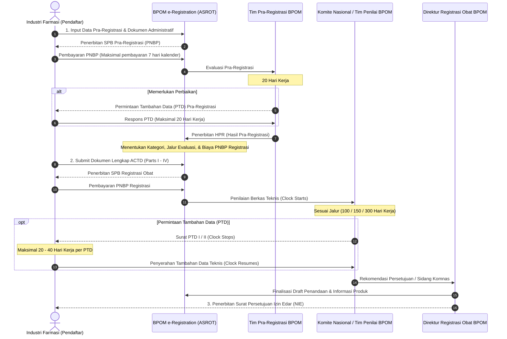

# BPOM Drug Submission Roadmap & Timeline Manual

This resource outlines the end-to-end regulatory pathway for obtaining and maintaining a Drug Marketing Authorization (*Nomor Izin Edar* / NIE) in Indonesia via the BPOM electronic registration system (ASROT - *Aplikasi Sistem Registrasi Obat Terpadu*).

---

## 1. End-to-End Submission Lifecycle

---

## 2. BPOM Evaluation Timelines (Hari Kerja)

*Berdasarkan Peraturan BPOM No. 24 Tahun 2017 jo. PerBPOM No. 13 Tahun 2022 dan Standar Pelayanan Publik BPOM:*

| Tahapan / Jenis Pendaftaran | Kategori Registrasi | Jalur Evaluasi Resmi | SLA Maksimal (Hari Kerja) | Keterangan Dokumen Kunci |
| :--- | :--- | :--- | :--- | :--- |
| **Pra-Registrasi** | Semua kategori (kecuali variasi notifikasi) | Pra-Registrasi | **20 Hari Kerja** | Bagian I, CPP, Dokumen GMP/CPOB, Justifikasi Formula |
| **Registrasi Baru: Jalur Cepat (Fast Track)** | Kategori 1, 2, 3 | **Jalur 100 Hari** | **100 Hari Kerja** | - Obat untuk penyakit serius/mengancam jiwa - Obat Program Kesehatan Nasional - Obat Inovasi baru (Orphan drug) - Obat esensial belum tersedia |
| **Registrasi Baru: Jalur Khusus / Lisensi** | Kategori 1, 2, 3 | **Jalur 150 Hari** | **150 Hari Kerja** | - Obat Copy Bermerek pertama - Obat generik esensial - Obat lisensi dari industri farmasi pemegang paten - Obat ekspor |
| **Registrasi Baru: Jalur Reguler** | Kategori 1, 2, 3 | **Jalur 300 Hari** | **300 Hari Kerja** | - Obat Entitas Kimiawi Baru (NCE) - Produk Biologi / Biosimilar - Obat Copy konvensional umum |
| **Registrasi Variasi Mayor (VaMa)** | Kategori 4 | Jalur Variasi Mayor | **100 Hari Kerja** | Perubahan spesifikasi/metode analisis API, perubahan indikasi/posologi, perluasan formula |
| **Registrasi Variasi Minor dgn Persetujuan (VaMi-B)** | Kategori 5 | Jalur Variasi Minor | **40 Hari Kerja** | Perubahan kemasan primer tanpa mengubah stabilitas, perubahan situs rilis bets |
| **Registrasi Variasi Minor Notifikasi (VaMi-A)** | Kategori 6 | Notifikasi Otomatis | **Langsung / Maks. 10 Hari** | Perubahan redaksional minor pada penandaan, perubahan nama distributor |
| **Registrasi Ulang (Renewal)** | Kategori 7 | Evaluasi / Notifikasi | **10 - 30 Hari Kerja** | Pengajuan 6 bulan sebelum masa berlaku NIE habis |

---

## 3. PTD (Permintaan Tambahan Data) Governance

1. **Jangka Waktu Pemenuhan PTD**:
   - PTD Pra-registrasi: Maksimal **20 hari kerja**.
   - PTD Registrasi Teknis (Parts II-IV): Maksimal **40 hari kerja** (dapat diperpanjang 1 kali dengan permohonan tertulis berdasar alasan teknis valid, misal penyelesaian pengujian stabilitas bets baru).
2. **Batas Maksimal Pengulangan PTD**:
   - Maksimal diberikan kesempatan pemenuhan tambahan data sebanyak **2 kali (PTD I dan PTD II)**.
   - Apabila pemohon tidak menyerahkan tambahan data dalam batas waktu atau data tetap tidak memenuhi kriteria mutu, khasiat, dan keamanan:
     - BPOM akan menerbitkan **Surat Penolakan / Keputusan Pembatalan Registrasi**.
     - Biaya PNBP yang telah disetor **hangus (tidak dapat dikembalikan)**.
3. **Mekanisme Dengar Pendapat (Hearing)**:
   - Pemohon berhak mengajukan permohonan klarifikasi teknis (Hearing) dengan evaluator BPOM jika terdapat perbedaan interpretasi ilmiah terkait data uji klinik atau disolusi terbanding.

---

## 4. Struktur Nomor Izin Edar (NIE) BPOM

Nomor Izin Edar obat jadi di Indonesia terdiri dari **15 digit kombinasi huruf dan angka**:

$$\mathbf{\text{Digit 1}} \quad \mathbf{\text{Digit 2}} \quad \mathbf{\text{Digit 3}} \quad \mathbf{\text{Digit 4-5}} \quad \mathbf{\text{Digit 6-8}} \quad \mathbf{\text{Digit 9-11}} \quad \mathbf{\text{Digit 12-13}} \quad \mathbf{\text{Digit 14}} \quad \mathbf{\text{Digit 15}}$$

*Contoh*: **DKL 1234567809 A 1**

- **Digit 1 (Nama Dagang / Generik)**:
  - `D`: Obat dengan Nama Dagang / Merek
  - `G`: Obat dengan Nama Generik
- **Digit 2 (Golongan Obat)**:
  - `K`: Golongan Obat Keras
  - `T`: Golongan Obat Bebas Terbatas
  - `B`: Golongan Obat Bebas
  - `N`: Golongan Narkotika
  - `P`: Golongan Psikotropika
- **Digit 3 (Asal Produksi)**:
  - `L`: Produksi Dalam Negeri (Lokal)
  - `I`: Produksi Luar Negeri (Impor)
  - `E`: Obat untuk keperluan Ekspor
  - `X`: Obat untuk keperluan Uji Klinik
- **Digit 4 - 5**: Tahun persetujuan pendaftaran (e.g., `24` = Tahun 2024).
- **Digit 6 - 8**: Nomor urut pabrik / industri farmasi di BPOM.
- **Digit 9 - 11**: Nomor urut obat yang disetujui untuk industri farmasi tersebut.
- **Digit 12 - 13**: Macam bentuk sediaan obat (e.g., `01` = Kapsul, `09` = Kaplet, `10` = Tablet, `29` = Krim, `43` = Injeksi).
- **Digit 14**: Kekuatan sediaan / variasi formula (`A` = Kekuatan ke-1, `B` = Kekuatan ke-2, dst.).
- **Digit 15**: Macam kemasan untuk kekuatan sediaan tersebut (`1` = Kemasan ke-1, `2` = Kemasan ke-2, dst.).
