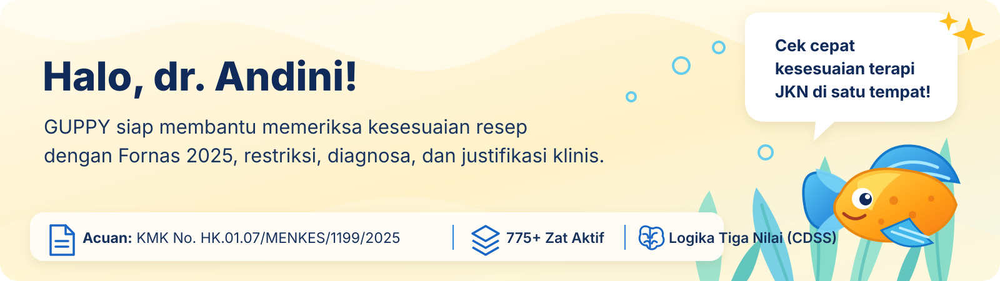

# 🐟 GUPPY – Clinical Pharmacy & Fornas 2025 Helper

<div align="center">



**Sistem Pendukung Keputusan Klinis (Clinical Decision Support System - CDSS) Farmasi Rumah Sakit & Fasilitas Kesehatan Primer Berbasis Kecerdasan Buatan (AI)**

[](https://www.python.org/downloads/)
[](https://streamlit.io)
[](https://docs.pytest.org/)
[](#)
[](#)

*Dikembangkan untuk Mata Kuliah: **Aplikasi AI dalam Industri Farmasi** (Program Magister Farmasi)*  
**Pengembang:** Apt. Indira Nureva, S.Farm. | **Platform AI:** Google Antigravity

</div>

---

## 📋 Daftar Isi
1. [Tentang Guppy](#1-tentang-guppy)
2. [Dasar Regulasi Resmi](#2-dasar-regulasi-resmi)
3. [Fitur-Fitur Utama](#3-fitur-fitur-utama)
4. [Tutorial & Panduan Langkah-demi-Langkah Penggunaan](#4-tutorial--panduan-langkah-demi-langkah-penggunaan)
   - [Langkah 1: Menjalankan Aplikasi](#langkah-1-menjalankan-aplikasi)
   - [Langkah 2: Mengatur Profil Pengguna (DPJP / Apoteker)](#langkah-2-mengatur-profil-pengguna-dpjp--apoteker)
   - [Langkah 3: Menelusuri Zat Aktif & Restriksi Fornas 2025 (Tab 1)](#langkah-3-menelusuri-zat-aktif--restriksi-fornas-2025-tab-1)
   - [Langkah 4: Melakukan Evaluasi Resep dengan Logika Tiga Nilai (Tab 2)](#langkah-4-melakukan-evaluasi-resep-dengan-logika-tiga-nilai-tab-2)
   - [Langkah 5: Membuat & Mengunduh Memo Justifikasi KFT Word (.docx) (Tab 3)](#langkah-5-membuat--mengunduh-memo-justifikasi-kft-word-docx-tab-3)
   - [Langkah 6: Melakukan Simulasi Klaim & Validasi INA-CBG (Tab 4)](#langkah-6-melakukan-simulasi-klaim--validasi-ina-cbg-tab-4)
   - [Langkah 7: Mengecek Acuan Regulasi & Status LinkGuard (Tab 5)](#langkah-7-mengecek-acuan-regulasi--status-linkguard-tab-5)
5. [Struktur Proyek](#5-struktur-proyek)
6. [Panduan Menjalankan Otomatisasi Pengujian (Pytest)](#6-panduan-menjalankan-otomatisasi-pengujian-pytest)
7. [Panduan Deployment Cloud & Docker](#7-panduan-deployment-cloud--docker)

---

## 1. Tentang Guppy

**Guppy Clinical Pharmacy & Fornas 2025 Helper** adalah aplikasi pintar berbasis web (*Streamlit*) yang dirancang khusus untuk membantu **Apoteker Farmasi Klinis, Dokter Spesialis / DPJP, Komite Farmasi & Terapi (KFT)**, dan **Verifikator Klaim BPJS Kesehatan** dalam mengevaluasi kesesuaian resep obat, memitigasi risiko klaim *dispute*, serta menyusun dokumen justifikasi medis yang *audit-ready*.

Aplikasi ini mengintegrasikan **logika inferensi tiga nilai (*Three-Valued Logic CDSS*)**, kamus sinonim bilingual medis, algoritma *Deep Search*, serta sintesis literatur ilmiah open-source terindeks Scopus (Q1–Q3 / PubMed).

---

## 2. Dasar Regulasi Resmi

Guppy dibangun di atas fondasi regulasi kefarmasian dan pelayanan kesehatan Republik Indonesia yang berlaku secara mutakhir:

* 🏛️ **Kepmenkes RI No. HK.01.07/MENKES/1199/2025 tentang Formularium Nasional (Fornas 2025)**  
  *(Mulai diberlakukan per 1 April 2026, secara resmi mencabut KMK 2197/2023 dan KMK 1818/2024)*.
* ⚖️ **Undang-Undang Republik Indonesia No. 17 Tahun 2023 tentang Kesehatan**.
* 📖 **9 Pedoman Nasional Pelayanan Kedokteran (PNPK 2025)** resmi terbitan Kementerian Kesehatan RI.
* 🏥 **Petunjuk Teknis Pelayanan Obat Jaminan Kesehatan Nasional (JKN) – BPJS Kesehatan**.
* 📘 **Farmakope Indonesia Edisi VI (FI VI)** dan Farmakope Herbal Indonesia.

---

## 3. Fitur-Fitur Utama

| Modul Fitur | Deskripsi Fungsional |
| :--- | :--- |
| **🔍 Fornas 2025 Deep Search** | Penelusuran cerdas zat aktif obat, kode ATC, bentuk sediaan, restriksi indikasi, dan batas peresepan maksimal menggunakan kamus sinonim bilingual (contoh: *Paracetamol* $\leftrightarrow$ *Acetaminophen*). |
| **⚖️ Three-Valued Logic CDSS** | Mesin inferensi klinis yang mengklasifikasikan kesesuaian resep ke dalam: 🟢 **Terpenuhi**, 🟡 **Tidak Diketahui (Perlu Konfirmasi)**, atau 🔴 **Tidak Terpenuhi**. |
| **📝 KFT Justification Generator** | Pembuat naskah justifikasi klinis komprehensif saat resep melampaui restriksi standar (misal: lini kedua, alergi obat lini 1, komorbiditas gawat). Dilengkapi kurasi multi-artikel Scopus Q1–Q3. |
| **📄 Export Microsoft Word (.docx)** | Ekspor memo justifikasi resmi langsung ke format `.docx` terformat rapi sesuai kop rumah sakit, siap cetak dan ditandatangani DPJP/Apoteker. |
| **📊 Claim & Dispute Simulation** | Simulasi validasi klaim tarif INA-CBG, peringatan dini potensi *dispute claim* BPJS, dan kepatuhan Program Rujuk Balik (PRB) / Obat Kanker. |
| **🛡️ LinkGuard Security Protection** | Sistem pengawasan integritas database dan tautan regulasi dengan indikator status 3 lampu (*Hijau: Aman, Orange: Dibatasi, Merah: Perlindungan Darurat*). |
| **🎨 Modern Pastel Clinical UI** | Antarmuka ramah pengguna dengan latar belakang vektor bertema akuatik, banner selamat datang resmi, dan maskot Guppy interaktif (*"Klik aku!"*). |

---

## 4. Tutorial & Panduan Langkah-demi-Langkah Penggunaan

### Langkah 1: Menjalankan Aplikasi

#### A. Menjalankan di Komputer Desktop / Laptop (Lokal Windows)
Tersedia dua cara mudah untuk meluncurkan Guppy di komputer Anda:
1. **Cara Paling Praktis (Tanpa Jendela Hitam CMD):**  
   Klik ganda pada berkas **`Buka_Guppy.vbs`** di folder utama proyek.  
   Browser web (*Chrome / Edge / Firefox*) akan otomatis terbuka langsung menuju `http://localhost:8501`.
2. **Cara Alternatif (Menggunakan Batch Script):**  
   Klik ganda berkas **`run_guppy.bat`**. Skrip akan memeriksa dependensi Python secara otomatis lalu membuka Guppy di browser.

#### B. Mengakses Versi Web Publik (Cloud Hosting)
Jika aplikasi telah di-deploy ke Streamlit Community Cloud atau server institusi, buka tautan publik aplikasi melalui browser apa pun (desktop, tablet, maupun ponsel pintar) tanpa perlu menginstal Python di perangkat Anda.

---

### Langkah 2: Mengatur Profil Pengguna (DPJP / Apoteker)

Sebelum melakukan telaah resep, pastikan identitas tenaga medis telah disesuaikan:

1. **Jika Sidebar Sedang Terbuka:**  
   Lihat di bilah samping kiri pada kartu **`👤 Profil Pengguna (Ganti Nama)`**.
2. **Jika Sidebar Sedang Tertutup:**  
   Klik tombol maskot ikan Guppy **"Klik aku!"** di pojok kiri atas untuk membuka bilah samping, atau klik tombol profil di bar atas dashboard.
3. **Ubah Informasi Profil:**
   * **Nama Pengguna:** Masukkan nama lengkap beserta gelar (contoh: `dr. Andini, Sp.PD` atau `Apt. Indira Nureva, S.Farm.`).
   * **Peran Profesi:** Pilih peran Anda (*Dokter Spesialis / DPJP, Dokter Umum, Apoteker Farmasi Klinis, Komite Farmasi & Terapi (KFT), atau Verifikator Klaim BPJS*).
   * **Tingkat Faskes:** Pilih `FPKTL (Rumah Sakit)` atau `FPKTP (Puskesmas / Klinik Primer)`.
4. Klik tombol **`💾 Simpan Perubahan Profil`**. Seluruh memo justifikasi dan telaah resep akan otomatis mengadopsi nama dan identitas faskes ini.

---

### Langkah 3: Menelusuri Zat Aktif & Restriksi Fornas 2025 (Tab 1)

Gunakan modul ini untuk mencari informasi resmi obat berdasarkan Kepmenkes Fornas 2025:

1. Klik menu **`🔍 Cari & Evaluasi Obat`** (Tab 1).
2. Ketik nama obat atau zat aktif pada kotak pencarian (misal: `Metformin`, `Candesartan`, `Atorvastatin`, atau nama generik lainnya).
   * *Fitur Deep Search Guppy mengenali padanan nama Indonesia maupun Inggris secara otomatis.*
3. Pilih obat dari daftar hasil pencarian. Sistem akan menampilkan kartu informasi lengkap:
   * **Kelas Terapi & Bentuk Sediaan:** Kekuatan dosis yang disetujui dalam Fornas 2025.
   * **Tingkat Fasilitas:** Indikator apakah obat dapat diresepkan di FKTP (1), FKRTL (2, 3), atau faskes rujukan khusus.
   * **Restriksi Penggunaan Klinis:** Syarat indikasi medis mutlak agar obat dapat dijamin oleh BPJS.
   * **Peresepan Maksimal:** Batas jumlah obat per resep atau per bulan (misal: *30 tablet/bulan*).
   * **Kode ICD-10 Usulan:** Diagnosis penyakit yang berkesesuaian menurut PNPK/Fornas.
4. Klik tombol **`⭐ Tambah ke Favorit`** jika obat ini sering diresepkan di bangsal Anda.

---

### Langkah 4: Melakukan Evaluasi Resep dengan Logika Tiga Nilai (Tab 2)

Modul CDSS inferensi untuk menguji apakah resep pasien memenuhi syarat regulasi:

1. Buka tab **`⚖️ Telaah Resep & CDSS`** (Tab 2).
2. Isi formulir parameter klinis pasien:
   * **Obat yang Diresepkan:** Pilih obat target dari basis data Fornas 2025.
   * **Diagnosis Klinis (ICD-10):** Pilih diagnosis pasien (misal: `E11 - Type 2 Diabetes Mellitus` atau `I10 - Essential Hypertension`).
   * **Fasilitas Pelayanan:** Pilih apakah resep dilayani di FKTP atau Rumah Sakit.
   * **Jumlah Peresepan:** Masukkan jumlah kuantitas obat yang diminta dalam resep.
   * **Riwayat Terapi / Catatan Khusus:** Masukkan kondisi komorbid atau riwayat kegagalan obat lini pertama jika ada.
3. Klik tombol **`🚀 Evaluasi Kesesuaian Resep`**.
4. Sistem akan menampilkan status keputusan inferensi:
   * 🟢 **TERPENUHI (COMPLIANT):** Resep sesuai dengan faskes, diagnosis ICD-10, dan peresepan maksimal Fornas 2025.
   * 🟡 **TIDAK DIKETAHUI / BUTUH JUSTIFIKASI:** Resep memerlukan konfirmasi data klinis tambahan dari dokter DPJP atau penyesuaian catatan rekam medis.
   * 🔴 **TIDAK TERPENUHI (NON-COMPLIANT):** Resep melampaui restriksi faskes/kuota, atau obat diresepkan di luar indikasi resmi Fornas.

---

### Langkah 5: Membuat & Mengunduh Memo Justifikasi KFT Word (.docx) (Tab 3)

Jika resep berstatus 🟡 atau 🔴 namun pasien sangat membutuhkan terapi tersebut secara medis (misal: resistensi lini pertama, alergi berat, atau komorbiditas khusus), dokter dan apoteker dapat menerbitkan **Memo Justifikasi Klinis**:

1. Buka tab **`📝 Generator Memo Justifikasi KFT`** (Tab 3).
2. Konfirmasikan nama pasien, nomor rekam medis (RM), dan kondisi klinis darurat/alasan klinis khusus.
3. Klik tombol **`⚡ Susun Naskah Justifikasi Klinis`**.
4. Sistem Guppy AI akan:
   * Mengambil dasar hukum Kepmenkes No. HK.01.07/MENKES/1199/2025 dan PNPK 2025 yang relevan.
   * Menyertakan sitasi artikel ilmiah terindeks Scopus (Q1–Q3 / PubMed) yang membuktikan efikasi terapi pada populasi khusus.
   * Menyusun naskah telaah farmasi terstruktur (*Latar Belakang, Analisis Farmakoterapi, Risiko Penghentian Obat, dan Rekomendasi Apoteker*).
5. **Unduh Berkas Microsoft Word:**  
   Klik tombol **`📥 Unduh Dokumen Word (.docx)`**. Berkas `.docx` dengan format rapi dan standar surat resmi institusi akan tersimpan di komputer Anda, siap ditandatangani dan diajukan ke rapat Komite Farmasi & Terapi (KFT) atau dilampirkan ke verifikator BPJS Kesehatan.

---

### Langkah 6: Melakukan Simulasi Klaim & Validasi INA-CBG (Tab 4)

Gunakan modul ini untuk mencegah berkas klaim rumah sakit dikembalikan (*pending/dispute claim*):

1. Masuk ke tab **`📊 Simulasi Klaim & Audit Tarif`** (Tab 4).
2. Masukkan kode paket INA-CBG dan daftar obat yang ditagihkan.
3. Sistem akan memvalidasi apakah obat termasuk dalam cakupan paket tarif INA-CBG, Program Rujuk Balik (PRB), obat kemoterapi kanker terpisah, atau obat restriksi khusus.
4. Tinjau rekomendasi perbaikan berkas klaim sebelum tagihan dikirimkan ke BPJS.

---

### Langkah 7: Mengecek Acuan Regulasi & Status LinkGuard (Tab 5)

Modul kepustakaan hukum kefarmasian dan keamanan data:

1. Buka tab **`📚 Referensi Regulasi & Keamanan`** (Tab 5).
2. Baca kutipan pasal penting dari UU No. 17/2023, Kepmenkes Fornas 2025, 9 PNPK Kemenkes, dan Farmakope Indonesia VI.
3. Periksa panel **Status Proteksi Sistem & Sumber Data (LinkGuard)**:
   * 🟢 **Lampu Hijau (Aman Semua):** Basis data regulasi dan tautan referensi berstatus valid dan terproteksi penuh.
   * 🟡 **Lampu Orange (Dibatasi Sementara):** Akses regulasi cadangan aktif dalam mode pengawasan.
   * 🔴 **Lampu Merah (Perlindungan Darurat):** Sistem beralih ke cache lokal terisolasi demi mencegah korupsi data.

---

## 5. Struktur Proyek

```text
Guppy_Clinical Pharmacy & Fornas 2025 Helper/
├── .agents/skills/                   # Agent skills & runbook regulasi farmasi klinis
├── .streamlit/
│   └── config.toml                   # Konfigurasi Streamlit (Light theme, auto browser launch)
├── assets/
│   └── images/                       # Folder aset gambar & vektor SVG resmi Guppy
│       ├── guppy-banner.svg          # Banner vektor dashboard utama
│       ├── guppy-sidebar-expanded.svg# Background sidebar saat terbuka
│       ├── guppy-sidebar-collapsed.svg# Background sidebar saat tertutup
│       └── guppy-sidebar-expand-button.svg # Tombol karakter maskot "Klik aku!"
├── guppy/
│   ├── backend/
│   │   ├── config.py                 # Pengaturan jalur berkas & konstanta regulasi
│   │   ├── engine/                   # Mesin inferensi klinis & klasifikasi resep
│   │   │   ├── fornas_matcher.py     # Mesin pencocokan Fornas 2025 & logika tiga nilai
│   │   │   ├── clinical_literature.py# Scopus Q1-Q3 literature scout & justification
│   │   │   ├── docx_generator.py     # Generator dokumen Microsoft Word (.docx)
│   │   │   └── security.py           # LinkGuard security & input sanitizer
│   │   └── knowledge/                # Basis data Fornas 2025 & PNPK terindeks
│   │       ├── fornas_2025.json      # Database resmi Kepmenkes 1199/2025
│   │       └── pnpk_2025.json        # Database 9 PNPK Kemenkes RI terbitan 2025
│   └── frontend/
│       ├── app.py                    # Aplikasi utama Streamlit CDSS Guppy
│       └── assets/
│           ├── style.css             # Desain antarmuka pastel modern & aturan kontras
│           └── guppy_logo.svg        # Logo vektor resmi Guppy
├── tests/                            # Pengujian unit otomatis (Pytest)
│   ├── test_fornas_matcher.py        # Uji logika pencocokan & tiga nilai
│   ├── test_clinical_literature.py   # Uji sitasi & generator justifikasi
│   ├── test_classifier.py            # Uji klasifikasi regulasi
│   ├── test_gap_analyzer.py          # Uji analisis kesesuaian ACTD
│   ├── test_roadmap.py               # Uji kalkulator SLA & NIE
│   └── test_security.py              # Uji keamanan LinkGuard & sanitasi input
├── Buka_Guppy.vbs                    # Peluncur instan satu klik (Windows silent runner)
├── run_guppy.bat                     # Peluncur aplikasi via Command Prompt
├── run_tests.bat                     # Peluncur otomasi pengujian Pytest
├── requirements.txt                  # Daftar dependensi pustaka Python
├── Dockerfile                        # Konfigurasi containerisasi Docker untuk cloud
└── RIWAYAT_REQUEST_DAN_PERUBAHAN.md  # Rekaman lengkap setiap request & histori Git
```

---

## 6. Panduan Menjalankan Otomatisasi Pengujian (Pytest)

Untuk memvalidasi bahwa seluruh modul inferensi klinis, pencocokan Fornas 2025, pembacaan literatur Scopus, dan proteksi LinkGuard berfungsi normal:

1. **Jalankan via Batch Script:**  
   Klik ganda pada berkas **`run_tests.bat`**.
2. **Jalankan via Terminal / PowerShell:**
   ```powershell
   & "$env:LOCALAPPDATA\Programs\Python\Python311\python.exe" -m pytest tests -v
   ```
3. **Hasil yang Diharapkan:**
   Seluruh **39 pengujian unit** akan berstatus hijau (*passed*):
   ```text
   ============================= 39 passed in 1.77s =============================
   ```

---

## 7. Panduan Deployment Cloud & Docker

Aplikasi Guppy siap di-deploy ke lingkungan produksi web publik:

### A. Deployment via Streamlit Community Cloud (Direkomendasikan)
1. Unggah kode ke repositori GitHub: [`https://github.com/Indiranureva/Guppy_Clinical-Pharmacy-Fornas-2025-Helper.git`](https://github.com/Indiranureva/Guppy_Clinical-Pharmacy-Fornas-2025-Helper.git).
2. Buka [share.streamlit.io](https://share.streamlit.io).
3. Pilih repositori, branch `main`, dan set *Main file path* ke:  
   `guppy/frontend/app.py`.
4. Klik **Deploy**. Aplikasi akan online dengan URL publik bersertifikat HTTPS otomatis.

### B. Deployment via Docker Container
Jalankan perintah berikut di direktori utama:
```bash
# Membangun image Docker
docker build -t guppy-app .

# Menjalankan kontainer pada port 8501
docker run -d -p 8501:8501 --name guppy_container guppy-app
```
Akses aplikasi melalui peramban di `http://localhost:8501`.

---

<div align="center">

**GUPPY: Menjembatani Regulasi Kefarmasian, Bukti Ilmiah Klinis, & Efisiensi Pelayanan Kesehatan Pasien.**  
*Magister Farmasi – Konsentrasi Farmasi Klinis & Kebijakan Obat.*

</div>
